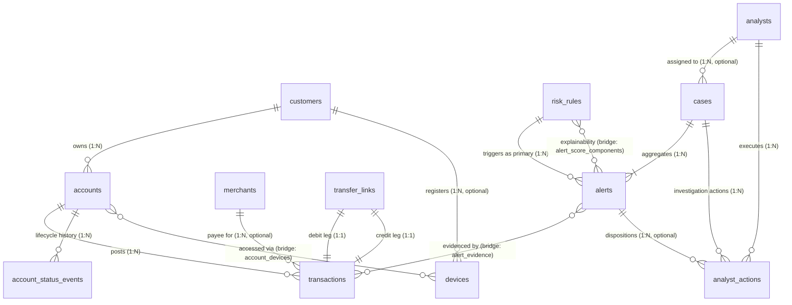

# Entity-Relationship Architecture & Cardinality Model

This document outlines the data model, entity relationships, cardinalities, optionality constraints, and effective-dating semantics implemented across the pipeline.

---

## 1. Entity-Relationship Overview

---

## 2. Cardinality & Relationship Catalog

| Relationship | Type | Parent | Child | Optionality | Effective-Dating / Lifecycle Notes |
|---|---|---|---|---|---|
| Customer to Account | `1:N` | `customers` | `accounts` | Mandatory (min 1, max 2) | Sub-account `-01` opened on customer onboarding date; optional `-02` opened between 30 and 900 days later. |
| Account to Transaction | `1:N` | `accounts` | `transactions` | Mandatory (min 1) | Immutable financial ledger records; ordered chronologically per account. |
| Account to Device | `N:M` | `accounts` | `devices` | Optional (via bridge `account_devices`) | Bridge tracks `first_seen_ts`, `last_seen_ts`, `txn_count`, and derives `link_status` (ACTIVE if seen within 90 days of DATA_END). |
| Customer to Device | `1:N` | `customers` | `devices` | Optional (`owner_customer_id` nullable) | Shared and fraud-pool devices have `owner_customer_id = NULL`. |
| Merchant to Transaction | `1:N` | `merchants` | `transactions` | Optional (`merchant_id` nullable) | Non-null only for POS purchases, bill payments, refunds, and merchant UPI payments. |
| Transfer Link to Transactions | `1:1 (each leg)` | `transfer_links` | `transactions` | Mandatory (exact 1 debit, 1 credit) | Bilateral linkage strictly enforces `debit_txn_id` (NEFT_TRANSFER_OUT) and `credit_txn_id` (TRANSFER_IN). |
| Account to Status Event | `1:N` | `accounts` | `account_status_events` | Mandatory (min 1) | Append-only event store. `accounts.status` is derived as the latest `to_status` by effective timestamp. |
| Risk Rule to Alert | `1:N` | `risk_rules` | `alerts` | Mandatory for alert (`rule_id` required) | Identifies the primary rule triggering the alert. |
| Alert to Rule Components | `N:M` | `alerts` | `risk_rules` | Optional (`rule_id` nullable in component) | Bridge table `alert_score_components` details every base point, bonus, tier increment, and adjustment. |
| Alert to Transaction Evidence | `N:M` | `alerts` | `transactions` | Optional (via bridge `alert_evidence`) | Flags transactions as either `TRIGGER` or `SUPPORTING`. Headless anomalies have zero evidence records. |
| Case to Alert | `1:N` | `cases` | `alerts` | Mandatory (min 1) | Cases aggregate correlated alerts across shared accounts and transaction evidence via union-find. |
| Case to Analyst Action | `1:N` | `cases` | `analyst_actions` | Mandatory (min 2: ASSIGN, REVIEW_START) | Append-only audit log tracking investigation states and reassignment events. |
| Alert to Analyst Action | `1:N` | `alerts` | `analyst_actions` | Optional (`alert_id` nullable on actions) | Non-null exclusively for `DISPOSITION` action records. |
| Analyst to Case | `1:N` | `analysts` | `cases` | Optional (`assigned_analyst_id` nullable) | Deterministically routed to operations analysts via CRC32 load-balancing hash. |

---

## 3. Effective-Dating & Append-Only State Semantics

1. **Immutable Financial History:** `transactions` records are never updated or deleted. Balance transitions follow the invariant $balance_{after} = balance_{before} \pm amount$.
2. **Account Status Journal:** Rather than overwriting account state, transitions null $\to$ `ACTIVE`, `ACTIVE` $\to$ `DORMANT`, `DORMANT` $\to$ `ACTIVE`, and `ACTIVE`/`DORMANT` $\to$ `CLOSED` are appended as `account_status_events`.
3. **Analyst Case State Tracking:** A case's lifecycle state (`OPEN`, `ASSIGNED`, `UNDER_REVIEW`, `ESCALATED`, `CLOSED`) is strictly derived from the most recent chronological record in `analyst_actions`.

